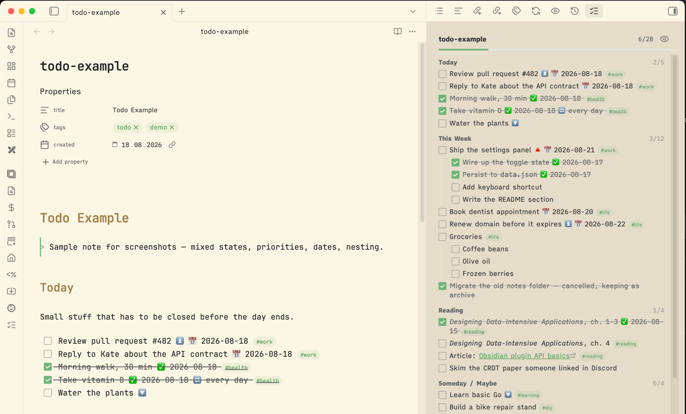

# Todo Sidebar

[](https://community.obsidian.md/plugins/todo-sidebar)

An Obsidian plugin that shows every checkbox from the **currently open note** in a sidebar panel.



Requires Obsidian 1.7.2 or newer (for the awaitable `revealLeaf`).

## What it does

- Lists all `- [ ]` / `- [x]` items of the active note in the right sidebar, nested the way they are in the note.
- Groups tasks under the heading they sit below, with a per-section `done/total`. Headings that contain no checkboxes are skipped, and clicking a heading jumps to it. Can be turned off in settings.
- Refreshes on note switch, rename, and when Obsidian re-indexes the note — i.e. shortly after a save, since tasks come from the metadata cache, which describes the file on disk (Obsidian's own save is debounced ~2s while you type).
- Click a checkbox in the panel to toggle it in the note (through the editor, so undo works). The panel updates immediately and the file is saved right away.
- Click a task row to jump the cursor to that line; links inside the text still open normally.
- Header shows a `done/total` count and a progress bar.
- Eye button in the header (or the command palette) toggles completed tasks in and out of view.
- Task text is rendered as markdown, so links, `**bold**`, and tags look right.
- Ignores checkboxes inside fenced code blocks and frontmatter, because Obsidian's metadata cache already does.

## Usage

Open the panel with the ribbon icon (checklist) or the command palette: **Show note tasks in sidebar**.

Commands:

- `Todo Sidebar: Show note tasks in sidebar`
- `Todo Sidebar: Toggle completed tasks visibility`

Settings: group by heading (on by default), hide completed tasks, open the panel automatically on
startup.

## Install

Settings → Community plugins → **Browse** → search **Todo Sidebar** → Install → Enable. Or open
the [directory listing](https://community.obsidian.md/plugins/todo-sidebar).

## Install a pre-release with BRAT

[BRAT](https://github.com/TfTHacker/obsidian42-brat) installs plugins straight from a GitHub
release and keeps them updated, so testers do not have to copy files by hand.

1. Install and enable **BRAT** from Settings → Community plugins → Browse.
2. Run the command **Add a beta plugin for testing**.
3. Enter the repository path: `andriyor/obsidian-todo-sidebar`.
4. Enable **Todo Sidebar** in Settings → Community plugins.

## Install manually

Download `main.js`, `manifest.json`, and `styles.css` from the
[latest release](https://github.com/andriyor/obsidian-todo-sidebar/releases/latest) into
`<vault>/.obsidian/plugins/todo-sidebar/`:

```bash
VAULT="/path/to/vault"
DEST="$VAULT/.obsidian/plugins/todo-sidebar"
mkdir -p "$DEST"
gh release download --repo andriyor/obsidian-todo-sidebar \
	-p main.js -p manifest.json -p styles.css -D "$DEST"
```

Then enable **Todo Sidebar** in Settings → Community plugins (Restricted mode off).

## Development

Node version in `.nvmrc`, pnpm pinned via `packageManager` in `package.json`.

```bash
pnpm install
pnpm dev     # esbuild watch mode → main.js
pnpm build   # typecheck + minified production bundle
pnpm test    # parser unit tests (node --test, no framework)
pnpm lint    # @e18e/eslint-plugin recommended (modernization + perf + banned deps)
```

`esbuild` is allowed to run its postinstall script via `allowBuilds` in
`pnpm-workspace.yaml` — pnpm blocks postinstall by default, and esbuild needs its to fetch
the platform binary.

Source lives in `src/`; `main.js` at the repo root is the generated bundle and is gitignored.

Symlink the repo into a vault so `pnpm dev` rebuilds land there directly:

```bash
ln -s "$PWD" "$VAULT/.obsidian/plugins/todo-sidebar"
```

Reload the plugin after a rebuild with the **Reload app without saving** command, or install
the Hot Reload plugin.

### Releasing

Releases install from the assets, so attach `main.js`, `manifest.json`, and `styles.css`. Tag,
release name, and the `version` in the released `manifest.json` must be identical — BRAT treats
the tag as the source of truth and warns if the manifest disagrees.

```bash
# bump version in manifest.json and package.json first
pnpm build   # main.js is gitignored, so build before attaching it
gh release create 1.0.0 main.js manifest.json styles.css --title 1.0.0
```

Add a `versions.json` entry only when `minAppVersion` changes. For a pre-release, use a matching
tag/name/version such as `1.0.1-beta.1` and mark the release as a pre-release.
